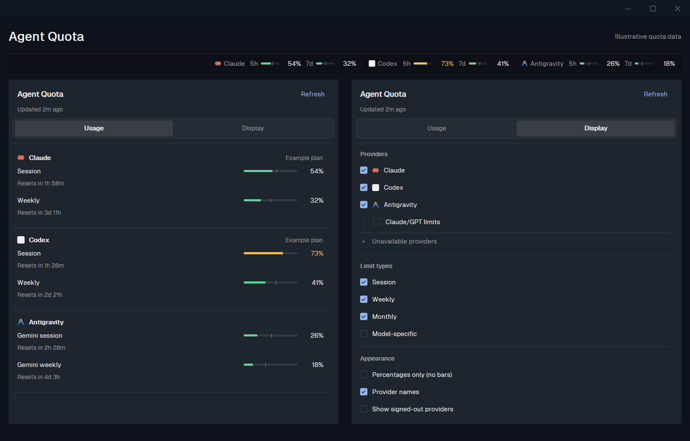

# Agent Quota

See your AI quota usage and reset times inside [Herdr](https://herdr.dev).
Agent Quota adds a compact status strip and a popup with two tabs: **Usage** for your limits,
and **Display** for choosing what appears. Quota data comes from
[quota-axi](https://github.com/kunchenguid/quota-axi), using the provider accounts already
authenticated on your computer.



These are native Herdr captures of the current mod, using illustrative quota data in an isolated
preview layout. They contain no terminal content or account identifiers. Values and plans are examples.

## Install

Tell your agent:

```text
Read ~/.config/herdr-app/AGENTS.md, then add this mod: https://github.com/jotafurtado/herdr-quota
```

## What it shows

- **Usage per limit**, not one combined percentage for an entire provider. Session, weekly,
  monthly and model-specific limits can appear separately when quota-axi reports them.
- **Reset countdowns** for limits with a future reset time.
- **Provider and plan names** when available. Claude, Codex, Antigravity and other supported
  providers appear according to the data returned by quota-axi.
- **Usage colors**: green below 60%, amber from 60%, orange from 80% and red from 92%.
- **Pace hints in the status strip**: a tick marks elapsed time when the limit includes a
  duration, and a small triangle warns when consumption is ahead of that pace.

Percentages mean **quota used**. The mod displays the provider's reported windows; it cannot
create a per-model breakdown when the provider only reports a shared allowance. Available
providers and limits depend on quota-axi and your local sign-ins.

## Usage and Display

Click or right-click the status strip to open the popup.

**Usage** groups available limits by provider, with percentages and reset countdowns.
Providers hidden from the strip remain accessible under **Other providers**.

**Display** lets you:

- Show or hide each provider in the strip.
- Select session, weekly, monthly and model-specific limit types for the strip.
- Hide Antigravity's Claude/GPT limits independently of its Gemini limits.
- Show provider names or signed-out providers in the strip.
- Enable **Percentages only (no bars)** in both the strip and popup.

Preferences apply immediately and persist across restarts. The strip uses compact labels such
as `5h` and `7d`. A monthly window is labeled `30d` only when its reported duration is exactly
30 days; otherwise it uses `mês`.

## Refresh and preferences

Quotas refresh automatically every two minutes. Select **Refresh** to update them immediately.
Your display preferences are saved locally and retained across restarts.

If a provider is missing, check the filters in Display. Your agent can check the dependency
and provider sign-ins when needed. Agent Quota reuses existing sign-ins and does not save access tokens.

## Credits and license

Independently maintained by [jotafurtado](https://github.com/jotafurtado), based on
[Lakris2407's original mod](https://github.com/Lakris2407/herdr-quota). Quota data is supplied by
[quota-axi](https://github.com/kunchenguid/quota-axi), by kunchenguid. Herdr supplies its mod API
and installed provider icons; additional bundled provider icons retain the LobeHub MIT notice.

MIT, with the original copyright preserved. See [LICENSE](LICENSE), [CREDITS.md](CREDITS.md),
[maintenance direction](MAINTENANCE.md) and [publishing on Herdr Mods](PUBLISHING.md).
