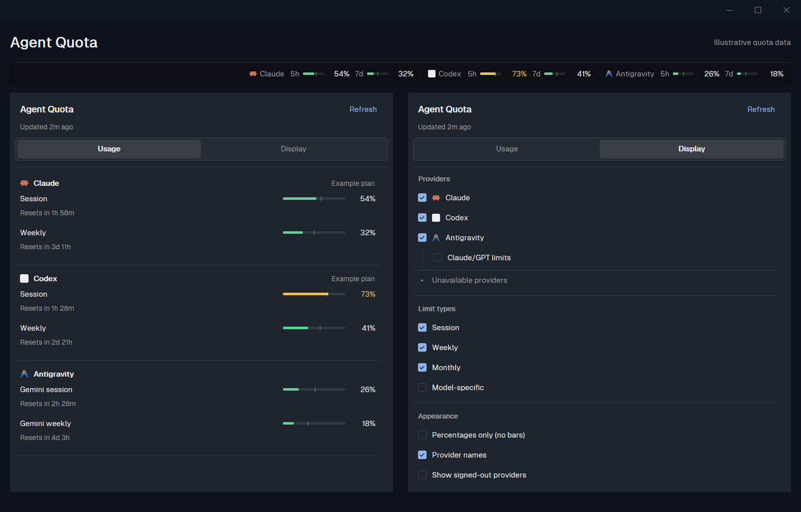

# Agent Quota

Build a Herdr mod that shows AI quota usage in a compact status strip and a popup with
Usage and Display tabs. Each provider can report separate session, weekly, monthly and
model-specific limits. Use quota-axi for data and the Herdr theme for the interface.



## What you see

- A 28 px status strip, with provider icons, optional provider names and each selected limit's
  compact period label, usage percentage and optional 34 x 4 px progress bar.
- Period labels: session hours, `7d` for weekly, `30d` for a monthly window only when its
  duration is exactly 2592000 seconds, otherwise `mês`. Keep window names when a provider has
  multiple limits of the same kind.
- A popup, 380 px wide and 640 px tall, with Agent Quota, Refresh, the update age, and tabs
  labeled Usage and Display. Scroll the tab content inside the fixed-height popup.
- Usage: each available provider has an icon, name and optional plan, followed by its limits,
  usage percentages, optional 100 x 4 px bars and future reset countdowns. Providers hidden
  from the strip live in a collapsed Other providers group.
- Display: available providers, an Antigravity Claude/GPT sub-option, a collapsed Unavailable
  providers group, Session/Weekly/Monthly/Model-specific checkboxes, and appearance controls
  for Percentages only (no bars), Provider names and Show signed-out providers.
- Use the bundled check glyph and the theme's accent for selected checkboxes. Keep unavailable
  provider explanations visible when that group is expanded.
- Use 12 px text for both period labels and percentages, in the strip and quota rows.
  Reserve 36 px for strip percentages and 40 px for popup percentages, aligned right.
  Titles use 14 px; section labels, plan names and reset countdowns use 11 px.
  Truncate long provider and limit labels with tooltips instead of changing the font size.

## Behavior

- Run `quota-axi --json` at startup, every two minutes and on Refresh. Query the local machine.
- Normalize each window to quota used: prefer a numeric `percentUsed`, otherwise derive it
  from a numeric `percentRemaining`. Keep its id, label, kind, reset time and duration.
- Cache normalized results in `quota.data`, errors in `quota.error` and preferences in
  `quota.options`. `quota.refresh` requests an immediate read. Do not save credentials.
- Keep the last successful data on a fetch error. Show errors in the popup; fade results to
  60% opacity after ten minutes. Distinguish loading, empty and failed states.
- Defaults: session, weekly and monthly limits on; model limits, provider names, signed-out
  providers, Antigravity Claude/GPT limits and percentage-only mode off; no hidden providers.
- Layout props supply starting choices. Saved popup choices win, including nested kind
  preferences. Apply changes immediately without closing the popup or mutating cached data.
- Kind filters affect the status strip. Usage retains available limits for inspection.
  The Antigravity sub-option hides only `agy` windows with ids beginning `claude_gpt_` in
  both views; preserve Gemini and the standalone Claude provider.
- Percentage-only mode removes bars and their ticks from both views. Retain numbers, labels,
  reset countdowns, usage colors and the status-strip pace warning.
- Usage colors, dark/light: below 60% green `#5ed49a`/`#1f9d63`, from 60% amber
  `#f2c14e`/`#c98a0b`, from 80% orange `#f59152`/`#dd6b20`, from 92% red `#f2665c`/`#d64545`.
- When a duration is known, place a thin tick at elapsed-window share. Add a small triangle
  when usage is at least 20% and at least ten percentage points ahead of elapsed time.
- Bind `quota:menu` and `quota:refresh` as optional key actions. CLI mod commands use dots:
  `herdr-app do quota.menu` and `herdr-app do quota.refresh`.

## Components and dependencies

`mods/quota/main.js` renders the strip and popup. `quota-command.js` launches quota-axi;
`quota-windows.js` holds the Antigravity window filter. The folder's `mod.json` uses
`place: none` and `title: Agent Quota`.

Use Herdr's `exec`, `theme`, `settings`, `shared`, `setShared`, `props`, `openOverlay`,
`knownAgents` and `nextCommand`, with native gpui-kit/gpui-base elements. The same view class
renders the popup when `props().menu` is true. Never retain a callback's `cx` for later use.

Try quota-axi directly. If it cannot start, try the fixed command
`cmd.exe /d /s /c "quota-axi --json"` for Windows npm shims. Preserve the Unix login-shell PATH
fallback. Never embed a personal Node installation path. Strip any shell banner before the
first JSON object. Quota-axi, rather than this mod, performs provider network requests.

Use Herdr's installed icons when available and bundled fallback provider icons otherwise.
Keep the included LobeHub MIT notice. Normalize known provider names and use initials if an
icon is unavailable. Do not require a provider to have a running agent terminal.

## Layout integration

Clone a shipped layout before editing it. Replace its status block with a row containing
workspace-status and quota. Give quota enough space for the selected limits; use the complete
block in the installation procedure below. Do not ship a layouts folder with this mod package. Many providers
may exceed the strip width; percentage-only mode and filters reduce the space required.

## Verification and previews

- Run `node --test tests/quota-command.test.mjs tests/quota-windows.test.mjs`.
- Run `herdr-app check mods/quota`, then inspect both tabs and live fetching in Herdr.
- Check persistence, defaults, provider filtering and both percentage-only states.
- Capture the current source in an isolated Herdr profile with illustrative quota data,
  no personal terminals, and no account identifiers. `preview.png` shows the strip above both tabs with bars.
- Preserve the original project's MIT notice and contributor attribution.

## Installation procedure for the agent

Read the user's Herdr `AGENTS.md` before installing. Handle dependency checks and layout
integration for the user rather than asking them to perform the manual steps below.

1. Check that `herdr-app` is available and resolve the active Herdr home, honoring `HERDR_APP_HOME`.
2. Run `quota-axi --json` to see whether the dependency is available and returns usable data.
   If quota-axi is missing and npm is available, install it with `npm install -g quota-axi`.
   Node.js and npm are needed for that installation; if they are missing, report that prerequisite.
3. Reuse the provider accounts already authenticated through tools supported by quota-axi.
   The mod does not perform provider login. If sign-in is needed, identify the affected
   provider and let the user complete its normal authentication flow. Never ask for tokens
   or copy credentials into the mod.
4. Inspect the current layout, install the full mod folder and integrate the status strip.
   Preserve personal layouts, preferences and keybindings. If `quota` is already installed,
   follow Herdr's collision rules rather than silently overwriting it.
5. Validate rendering and quota fetching and show the installed result.

### Manual reference

1. Copy the entire `mods/quota` directory, including its JavaScript helpers and `icons`, into
   your Herdr home. The default is `~/.config/herdr-app` on Windows, macOS and Linux;
   use `HERDR_APP_HOME` instead if you configured a custom home. Back up an existing quota
   mod before replacing it.
2. Clone Herdr's shipped layout so your changes survive app updates:

   ```sh
   herdr-app do layout.clone --name main --as main-quota
   ```

3. In `layouts/main-quota.json`, replace the existing `status` block with:

   ```json
   {
     "id": "status",
     "type": "row",
     "size": { "px": 28 },
     "resizable": false,
     "children": [
       {
         "id": "status-main",
         "type": "block",
         "content": { "mod": "workspace-status" },
         "size": { "weight": 1 }
       },
       {
         "id": "status-quota",
         "type": "block",
         "content": { "mod": "quota" },
         "size": { "weight": 4 },
         "min": 240
       }
     ]
   }
   ```

4. Validate using the full path to the installed mod:

   ```sh
   herdr-app check ~/.config/herdr-app/mods/quota
   herdr-app do layout.switch --name main-quota
   ```

   On PowerShell, use `"$env:USERPROFILE/.config/herdr-app/mods/quota"` for that path.
   If `main-quota` already exists, choose another name when cloning and switching.


### Defaults and layout props

Session, weekly and monthly limits are enabled by default. Model-specific limits, provider
names, signed-out providers, Antigravity Claude/GPT limits and percentage-only mode are disabled.

The quota block's `content.props` can supply starting preferences:

```json
{
  "mod": "quota",
  "props": {
    "percentageOnly": true,
    "names": true,
    "hidden": ["cursor"],
    "agyClaudeGpt": false,
    "kinds": { "session": true, "weekly": true, "monthly": true, "model": false }
  }
}
```

The additional `signedOut` option defaults to `false`. Saved choices from Display take
precedence over layout props. Existing preferences are retained when upgrading.

Optional bindings in Herdr's `keys.json` can use `quota:menu` and `quota:refresh` as actions.
From the terminal, use `herdr-app do quota.menu` and `herdr-app do quota.refresh`.


### Data and troubleshooting

The mod runs `quota-axi --json` at startup, every two minutes and when you select **Refresh**.
It reads quotas on this computer, even when the active terminal belongs to a remote machine.

On Windows, it supports npm's `.cmd` launcher through `cmd.exe`; no fixed Node installation
path is required. The Unix fallback asks your login shell to find quota-axi. The helper tests
cover launcher selection; macOS and Linux have not been verified on hardware for this revision.

The mod makes no direct network requests. Quota-axi contacts providers using its own supported
credential sources. Agent Quota saves normalized quota results, plan names, errors and display
preferences in Herdr's local shared state. It does not save access tokens.

If the strip says **Quota unavailable**, run `quota-axi --json` and check your PATH and sign-ins.
If no quotas appear, check the provider and limit filters in Display. A faded strip means its
cached data is more than ten minutes old. Many visible limits can exceed the available strip
width; allocate more space, hide limits or use percentage-only mode.
